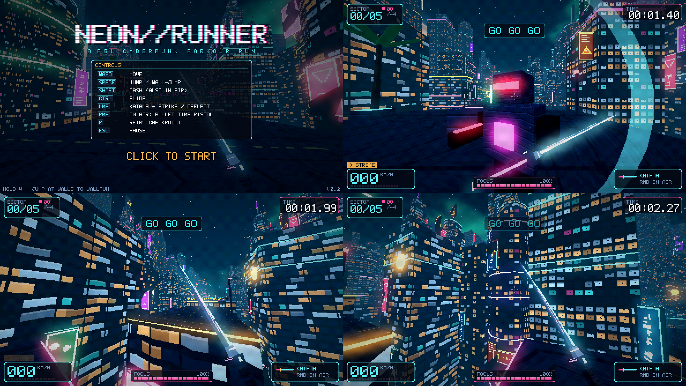

# NEON//RUNNER

A fast PS1-style first-person parkour run through a neon cyberpunk city, inspired by Ghostrunner.
Wall-run across giant ad screens, vault and mantle across rooftops, cut down gunners with a neon katana, and draw a pistol in mid-air to slow time.

## Download

**[Latest release: v0.2.0](https://github.com/Cluelessmate/NeonRunner-builds/releases/latest)**

| Platform | File |
|---|---|
| Windows (64-bit) | `NeonRunner-v0.2.0-windows.zip` → extract → run `NeonRunner.exe` |
| Linux (x86_64) | `NeonRunner-v0.2.0-linux.zip` → extract → `chmod +x NeonRunner.x86_64` → run |

Windows SmartScreen may warn about an unsigned app: click **More info → Run anyway**.

## Controls

| Action | Key |
|---|---|
| Move | WASD |
| Jump / wall-jump | Space |
| Dash (also in the air) | Shift |
| Slide | Ctrl |
| Katana: slash, lunge, deflect shots | Left mouse |
| In the air: draw pistol + bullet time | Hold right mouse |
| Fire pistol | Left mouse while aiming |
| Retry from checkpoint | R |
| Pause | Esc |

**Tips:** hold W and jump at a wall to wall-run. Run into anything waist-high to vault it, and jump into ledges to mantle up. One hit kills you, and one hit kills enemies. Gunners' visors flash just before they fire.

---
This repository only hosts builds. The source code is private.

